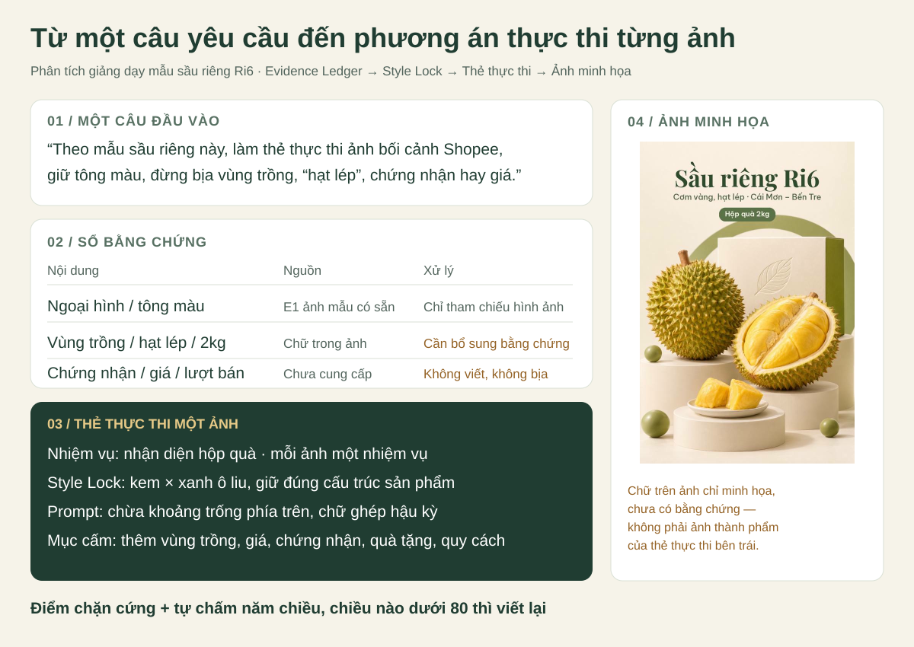
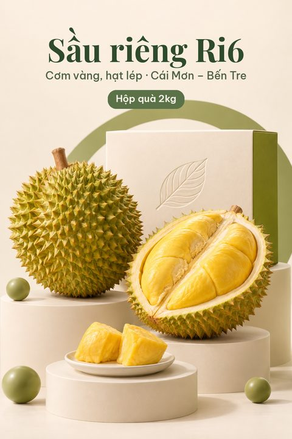
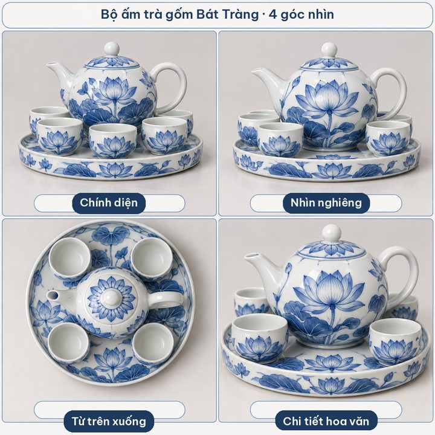

<div align="center">

# 🛒 E-commerce Visual Copywriting

### Kế hoạch hình ảnh TMĐT · Ảnh chính / Trang chi tiết / Listing / A+ · Chữ trên ảnh · Prompt tạo ảnh · Kiểm tra tuân thủ

**Biến tài liệu sản phẩm rời rạc thành phương án hình ảnh mà designer và AI đều làm theo được ngay.**

[](SKILL.md)
[](SKILL.md)
[](https://skills.sh/feichanggege/ecommerce-visual-copywriting-skill)
[](LICENSE)
[](https://github.com/feichanggege/ecommerce-visual-copywriting-skill/actions/workflows/verify.yml)

**Tiếng Việt** · [English](README.en.md)

[Bắt đầu trong 30 giây](#-bắt-đầu-trong-30-giây) · [Giải quyết vấn đề gì](#-giải-quyết-vấn-đề-gì) · [Quy trình](#-quy-trình) · [Nền tảng hỗ trợ](#-nền-tảng-hỗ-trợ) · [Ảnh minh họa](#-ảnh-minh-họa) · [Ranh giới an toàn](#-ranh-giới-an-toàn)

</div>

<p align="center">
  
</p>

Sơ đồ là bài phân tích giảng dạy dựa trên ảnh mẫu sầu riêng Ri6: một câu đầu vào → sổ bằng chứng → thẻ thực thi một ảnh → ảnh tham chiếu. [Xem đầy đủ đầu vào, bằng chứng và thẻ thực thi](examples/durian-worked-example.md).

Skill xác nhận nhận diện sản phẩm trước, lập **Sổ bằng chứng**, rồi làm rõ lý do mua, khóa **Style Lock**, và giao khung hình, nội dung, ghi chú dàn trang cùng Prompt cho từng ảnh.

---

## ✨ Giải quyết vấn đề gì

AI thông thường làm hình ảnh TMĐT, vấn đề hay gặp không phải “không biết viết”, mà là:

| Vấn đề thường gặp | Cách Skill xử lý |
|---|---|
| Dồn điểm bán, 5 ảnh nói cùng một ý | Mỗi ảnh chỉ giải quyết một câu hỏi quyết định mua |
| Càng sửa ảnh tham chiếu càng không giống sản phẩm gốc | Khóa bao bì, logo, cấu trúc, quy cách |
| “Viết mạnh vào” rồi sinh ra công dụng, từ tuyệt đối, bằng chứng giả | Lập sổ bằng chứng trước, rồi phân cấp tuyên bố |
| Chỉ muốn sửa trang chi tiết có sẵn nhưng bị làm lại từ đầu | Tự vào chế độ kiểm tra/sửa bản, chỉ sửa phần cần thiết |
| Trang bán xuyên biên giới chỉ là bản dịch tiếng Việt | Viết lại theo thị trường, đơn vị, bối cảnh, thói quen diễn đạt |
| Quy định nền tảng đã đổi, AI vẫn dùng kinh nghiệm cũ | Khi cần, ưu tiên kiểm tra nguồn chính thức mới nhất |
| Đầu ra chỉ có chữ, designer vẫn phải đoán | Giao từng ảnh: khung hình + chữ + ghi chú thiết kế + Prompt + mục cấm |

---

## 🚀 Bắt đầu trong 30 giây

### 1. Cài đặt

```bash
npx skills add feichanggege/ecommerce-visual-copywriting-skill
```

Cũng hỗ trợ [cài thủ công cho Codex / Claude Code, Claude plugin marketplace và tải ZIP lên Claude.ai](#cài-thủ-công).

### 2. Nói thẳng yêu cầu

```text
Đây là tài liệu sản phẩm, ảnh bao bì và ảnh tham khảo đối thủ của mình.
Bán trên Shopee, làm luôn 7 ảnh sản phẩm + kế hoạch trang chi tiết:
mỗi ảnh có khung hình, chữ trên ảnh tiếng Việt, ghi chú thiết kế, Prompt tạo ảnh và Negative Prompt.
Đừng hỏi giữa chừng, thông tin thiếu thì ghi giả định, không được bịa.
```

Hoặc đơn giản hơn:

```text
Làm giúp mình bộ ảnh chính và trang chi tiết cho sản phẩm này, đưa designer làm được ngay.
```

---

## 🧭 Quy trình

Xác nhận đang bán gì và ranh giới bằng chứng trước, rồi làm rõ lý do mua, khóa phong cách hình ảnh, cuối cùng viết bản thực thi bắt tay làm được cho từng ảnh. Ảnh đầu tiên phải giúp nhận ra sản phẩm.

| Bước | Làm gì | Đầu ra |
|---|---|---|
| 0 Xác định nhiệm vụ | Xác định làm ảnh chính, trang chi tiết hay sửa bản; thiếu tên sản phẩm thì hỏi người dùng cho tên hoặc cho phép đặt tên theo ảnh; sở thích về nền tảng, phong cách, điểm bán chỉ hỏi một vòng, có thể dùng giả định mặc định | Phạm vi nhiệm vụ, tài liệu đã biết, giả định và chỗ thiếu |
| 1 Kiểm điểm bán | Đối chiếu từng điểm bán với tài liệu sản phẩm, ghi nguồn và phạm vi áp dụng | Sổ bằng chứng (Đã xác nhận / Có căn cứ / Cần bổ sung bằng chứng / Cấm) |
| 2 Tìm lý do chốt đơn | Chọn 1 động lực chính và tối đa 1 động lực phụ | Động lực chốt đơn, tối đa 3 lý do mua có căn cứ |
| 3 Khóa phong cách | Cố định ngoại hình sản phẩm, bố cục, màu, ánh sáng, font, tránh bộ ảnh lệch tông | Campaign Style Lock |
| 4 Lên kế hoạch ảnh | KV1 giúp nhận ra sản phẩm; các ảnh khác mỗi ảnh gánh một câu hỏi quyết định, tăng giảm theo lượng thông tin thật | Storyboard (5 ảnh chỉ là điểm xuất phát) |
| 5 Ra bản từng ảnh | Viết khung hình, chữ trên ảnh, dàn trang, Prompt, mục cấm và bằng chứng | Thẻ thực thi từng ảnh, có cách render chữ và tự kiểm quy cách chữ |
| 6 Tự chấm trước khi giao | Kiểm điểm chặn cứng trước, rồi chấm 5 chiều theo điều kiện bắt buộc; chiều nào dưới 80 thì viết lại, tối đa 2 vòng | Bản thực thi qua tự chấm + biên bản tự chấm; ảnh thành phẩm nghiệm thu riêng |

> Các bước lấy theo phạm vi lần này: giao một lần thì không dừng máy móc; chế độ chuẩn chỉ gộp xác nhận một lần sau Storyboard; bảng hỏi sở thích chỉ gửi một vòng, đều tùy chọn, nói “làm luôn” là bỏ qua; thiếu tên vẫn hỏi trước, đã cho phép đặt tên theo ảnh thì không hỏi lại; đã có thành phẩm cần kiểm thì chỉ sửa phần cần thiết. Chưa kiểm ảnh thành phẩm thật thì các mục nghiệm thu liên quan ghi “chờ nghiệm thu”.

### Bốn chế độ thực thi

| Chế độ | Khi nào dùng | Hành vi |
|---|---|---|
| **Chế độ chuẩn** | Thiếu bằng chứng then chốt, hướng chưa rõ, người dùng muốn xác nhận trước | Chiến lược và chỗ thiếu bằng chứng → gộp xác nhận một lần sau Storyboard → thực thi |
| **Giao một lần** | Người dùng nói rõ “làm hết luôn” hoặc tài liệu đầy đủ | Không dừng máy móc, giao trọn |
| **Kiểm tra / sửa bản** | Đã có ảnh chính, trang chi tiết, nội dung, Prompt | Tìm vấn đề + sửa tối thiểu cần thiết |
| **Bàn giao cho designer** | Cần bản thực thi bắt tay làm ngay | Xuất thẻ nhiệm vụ từng ảnh theo cấu trúc cố định |

Không chỉ định chế độ thì xét theo thứ tự: đã có thành phẩm cần kiểm → kiểm tra; cần đưa designer/vận hành dùng ngay → bàn giao; tài liệu và bằng chứng cần thiết cho phạm vi lần này đầy đủ → giao một lần; thiếu bằng chứng hoặc hướng chưa rõ → chế độ chuẩn. Ảnh sản phẩm gốc là tài liệu đầu vào, không tự kích hoạt kiểm tra, cũng không ép cho đủ ba điểm bán. Mọi phương án/chiến lược/phân cảnh đầy đủ và báo cáo kiểm tra chính thức đều dùng chung một [mẫu đầu ra](references/output-contracts.md).

### Năng lực cốt lõi bản v3

- **Evidence Ledger / Sổ bằng chứng**: mỗi điểm bán then chốt gắn nhãn “Đã xác nhận / Có căn cứ / Cần bổ sung bằng chứng / Cấm”.
- **Reference Fidelity**: chỉ rõ yếu tố nào phải giữ, yếu tố nào được thay đổi.
- **Negative Prompt**: đưa trước méo bao bì, sai logo, đổi quy cách, chữ lỗi, người dị dạng… vào mục cấm.
- **Số ảnh linh hoạt**: 5 ảnh chỉ là mặc định, không làm cố cho đủ 5.
- **KV1 ưu tiên nhận diện sản phẩm**: đã có tên thì dùng luôn, thiếu tên thì hỏi người dùng cho tên hoặc cho phép đặt tên theo ảnh; tên rõ ràng và không vượt số tiếng thì làm tiêu đề chính, kiểu dáng và điểm bán ở tầng hai. Che phụ đề vẫn phải nhận ra sản phẩm; các ảnh đặc tính sau nói thẳng đặc tính. Người dùng yêu cầu không thêm chữ hoặc vị trí nền tảng không cho ghép chữ thì nhận diện bằng chủ thể sản phẩm thật. Xem [hai ví dụ tên gốc](examples/README.md#example-7-ảnh-đầu-nói-sản-phẩm-trước-giữ-tên-gốc).
- **Playbook đa nền tảng**: Shopee / Lazada / TikTok Shop / Tiki / Sendo / Facebook–Zalo + Amazon / Shopify / Temu.
- **Quy tắc chữ và dàn trang**: ảnh chính 1 tiêu đề + tối đa 2 phụ đề + tối đa 1 nhãn số/bằng chứng; module PDP 1 tiêu đề + tối đa 3 ý. Tiêu đề ≤8 tiếng/≤6 từ tiếng Anh; phụ đề ảnh chính mỗi dòng ≤14 tiếng/≤10 từ tiếng Anh, ý PDP mỗi dòng ≤14 tiếng/≤12 từ tiếng Anh. Đều là giá trị khuyến nghị mặc định, không phải quy định nền tảng; vượt thì cắt bớt hoặc tách ảnh.
- **Chọn một trong hai cách render chữ**: mỗi thẻ chọn “chừa khoảng trống” (mặc định ghép chữ hậu kỳ) hoặc “mô hình tạo chữ” (chỉ chữ ngắn được yêu cầu rõ), kèm tự kiểm quy cách chữ, nghiệm thu từng chữ, từng dấu và cách dự phòng. Tuyên bố ở đáy phải đọc được, điều kiện quan trọng đặt sát tuyên bố.
- **Sáu loại động lực chốt đơn**: thị giác / nỗi đau / thông số / niềm tin / cảm xúc / giá và combo khuyến mãi; giá phải đối chiếu SKU, số lượng, ngưỡng ưu đãi và thời gian chương trình.
- **Bản địa hóa xuyên biên giới**: không dịch từng chữ, viết lại lý do mua, đơn vị, bối cảnh và mật độ thông tin.
- **Điểm chặn cứng + ngưỡng tự chấm 80**: năm chiều đều neo theo điều kiện bắt buộc, chiều nào dưới 80 thì viết lại (tối đa 2 vòng), khi giao kèm *Biên bản tự chấm*; không chấm cảm tính kiểu “80/100” không có mốc.
- **Quy tắc nội dung theo Luật Quảng cáo Việt Nam**: ảnh chính/ảnh chi tiết xét ngành hàng và tuyên bố được phép trước, rồi kiểm từng thẻ; mặc định không dùng so sánh nhất, ám chỉ y tế. Nguồn trích dẫn và điều kiện cần thiết phải ở lớp chữ nhìn thấy được, không giấu trong ghi chú nội bộ hay chữ quá nhỏ.

---

## 📦 Giao được gì

### Chiến lược hình ảnh

- Động lực chốt đơn: thị giác / nỗi đau / thông số / niềm tin / cảm xúc / giá và combo khuyến mãi
- Tối đa 3 lý do mua có căn cứ
- Sổ bằng chứng
- `Feature → Advantage → Benefit → Evidence`
- Campaign Style Lock
- Thông tin thiếu, giả định và rủi ro

### Storyboard

```text
KV1  Hero      → Nhận ra đây là sản phẩm gì trước; điểm bán ở tầng hai, có thể lược
KV2  Benefit   → Chuyển thông số cốt lõi thành lợi ích cho người dùng
KV3  Proof     → Tạo niềm tin bằng bằng chứng thật
KV4  Scene     → Cho khách mục tiêu thấy bối cảnh dùng của chính họ
KV5  Spec/CTA  → Quy cách, combo, lựa chọn hoặc thông tin hành động
```

> Số ảnh thực tế điều chỉnh theo nền tảng và sản phẩm, không cố định 5 ảnh.

### Thẻ thực thi một ảnh

Mỗi ảnh giao được ngay:

- Nhiệm vụ hình ảnh
- Tên sản phẩm gốc/ngành hàng và tự kiểm KV1 nhận diện (chỉ áp dụng ảnh đầu)
- Khung hình / bố cục / ống kính / ánh sáng / nền
- Chữ trên ảnh
- Cách render chữ, tự kiểm quy cách chữ và cách nghiệm thu/dự phòng chữ
- Dàn trang và vị trí tuyên bố
- Điểm nhìn đầu tiên
- Ghi chú thiết kế
- Prompt tạo ảnh
- Negative Prompt / mục cấm
- Nguồn bằng chứng
- Ghi chú tuân thủ / nền tảng

---

## 🌍 Nền tảng hỗ trợ

| Trong nước | Xuyên biên giới / DTC |
|---|---|
| Shopee Việt Nam (Shopee Mall) | Amazon Listing / A+ / Brand Story |
| Lazada Việt Nam (LazMall) | Shopify / website riêng (DTC PDP) |
| TikTok Shop Việt Nam | Temu |
| Tiki / Sendo | Shopee / Lazada các nước khác |
| Facebook / Instagram / Zalo shop | Các bối cảnh trang chi tiết khác |

Nội dung liên quan nền tảng chia hai loại:

1. **Chiến lược hình ảnh ổn định lâu dài**: dùng `references/platform-playbooks.md`.
2. **Kích thước hiện hành, giới hạn ảnh chính, từ cấm, giấy tờ, quy định duyệt**: khi cần, ưu tiên kiểm nguồn chính thức mới nhất của nền tảng, không viết kinh nghiệm cũ thành quy định hiện hành.

Mỗi nền tảng trong nước có đoạn riêng, quy định xuyên biên giới kiểm theo từng nước/site. [Danh mục nguồn chính thức](references/source-notes.md) phân biệt văn bản pháp luật, cổng quy định và các giới hạn đăng nhập/truy cập.

---

## 🧪 Cách dùng điển hình

### Lên kế hoạch trước rồi thực thi

```text
Làm giúp mình bộ ảnh chính và trang chi tiết Shopee.
Xác định động lực chốt đơn, Style Lock và phân cảnh trước, mình xác nhận rồi mới làm bản cuối.
```

### Giao trọn một lần

```text
Tài liệu đủ rồi, làm hết một lần luôn, không cần xác nhận giữa chừng.
Xuất ảnh chính, trang chi tiết, chữ trên ảnh, ghi chú thiết kế và Prompt tạo ảnh.
```

### Kiểm tra trang có sẵn

```text
Đừng làm lại. Kiểm giúp bộ trang chi tiết này chỗ nào ảnh hưởng chuyển đổi, chỗ nào có rủi ro tuân thủ,
đưa phương án sửa tối thiểu và bản đã sửa theo thứ tự ưu tiên.
```

### Trung thực với ảnh tham chiếu

```text
Làm ảnh chính dựa theo ảnh bao bì này.
Logo, màu bao bì, quy cách, dáng hũ không được đổi; bối cảnh và ánh sáng đổi được.
```

### Bản địa hóa xuyên biên giới

```text
Chuyển bộ trang chi tiết tiếng Việt này thành bản tiếng Anh cho Shopify US.
Đừng dịch từng chữ, viết lại theo logic mua hàng của khách Mỹ.
```

Xem thêm ví dụ ở [examples/README.md](examples/README.md).

---

## 🖼 Ảnh minh họa

<div align="center">
  <table>
    <tr>
      <td align="center" width="50%">
        <a href="assets/showcase/sau-rieng-ri6-main.jpg">
          
        </a><br>
        <strong>Hero / ảnh chính nông sản cao cấp</strong>
      </td>
      <td align="center" width="50%">
        <a href="assets/showcase/am-tra-bat-trang-multi-angle.jpg">
          
        </a><br>
        <strong>Thể hiện sản phẩm nhiều góc</strong>
      </td>
    </tr>
    <tr>
      <td align="center" width="50%">
        <a href="assets/showcase/am-tra-bat-trang-scene.jpg">
          
        </a><br>
        <strong>Module trang chi tiết bối cảnh thật</strong>
      </td>
      <td align="center" width="50%">
        <a href="assets/showcase/den-long-hoi-an.jpg">
          
        </a><br>
        <strong>Thể hiện chất liệu và ánh sáng</strong>
      </td>
    </tr>
  </table>
</div>

> Ảnh minh họa do AI tạo để mô tả hình thức giao hàng, không phải ảnh sản phẩm thật, không đại diện ý kiến pháp lý, cam kết duyệt của nền tảng hay bằng chứng dữ liệu thương mại cho sản phẩm tương ứng. Chữ trên ảnh (ví dụ vùng trồng, “hạt lép”, khối lượng) chỉ là minh họa, chưa có bằng chứng.

Mỗi ảnh ≤500KB, ảnh thu nhỏ sầu riêng giữ đủ tỷ lệ dọc. Ảnh lớn cũ vẫn nằm trong lịch sử Git; muốn tải nhanh hãy dùng shallow clone hoặc tải gói mã nguồn hiện tại.

---

## 🛡 Ranh giới an toàn

Skill này **không**:

- Bịa báo cáo kiểm nghiệm, chứng nhận, bằng sáng chế, số công bố/giấy phép, doanh số, đánh giá, xếp hạng hay lời chứng thực của khách.
- Viết nội dung “cần bổ sung bằng chứng” thành sự thật chắc chắn.
- Vượt ranh giới tuân thủ y tế, thực phẩm, sức khỏe hay nền tảng chỉ vì người dùng muốn “mạnh hơn”.
- Dùng một câu miễn trừ để “tẩy trắng” tuyên bố công dụng vốn không được phép.
- Coi kinh nghiệm nền tảng cũ là quy định cứng hiện hành.
- Tự ý làm sai bao bì, logo, quy cách hay cấu trúc sản phẩm vì hiệu ứng hình ảnh.

Khung tuân thủ xem [references/compliance-rules.md](references/compliance-rules.md).

Ảnh chính, ảnh chi tiết và sửa bản cục bộ cho thị trường Việt Nam bắt buộc đọc [quy tắc thực thi nội dung tại Việt Nam](references/compliance-rules.md#10-thực-thi-nội-dung-ảnh-chínhảnh-chi-tiết-tại-việt-nam). Đã bổ sung theo Luật Quảng cáo, Luật Bảo vệ quyền lợi người tiêu dùng và các nghị định liên quan về giới hạn ngành hàng, ranh giới xếp hạng/so sánh, điều kiện phải đọc được và yêu cầu xác nhận nội dung quảng cáo theo luật; ngoại lệ tiềm năng để ngoài bản giao cho người rà soát, sự đồng ý của con người không thể cho qua nội dung pháp luật cấm. Đầu ra phân biệt “lớp chữ cuối cùng” và ghi chú rủi ro, không cam kết “đạt chuẩn Luật Quảng cáo” hay bảo đảm được duyệt. Đây không phải tư vấn pháp lý. [Nguồn chính thức và phạm vi kiểm tra lần này](references/source-notes.md).

---

## 🗂 Cấu trúc repo

```text
SKILL.md                          # Canonical runtime entrypoint (tiếng Việt)
SKILL.en.md                       # Bản quy tắc tiếng Anh đầy đủ, đối ứng từng mục
agents/openai.yaml                # ChatGPT UI metadata
references/compliance-rules.md    # Khung bằng chứng và tuân thủ
references/platform-playbooks.md  # Chiến lược hình ảnh đa nền tảng
references/output-contracts.md    # Mẫu bàn giao designer / kiểm tra / bản địa hóa
references/copy-quality-rules.md  # Quy tắc chất lượng nội dung và ví dụ đúng/sai
references/category-notes.md      # Ghi chú ngành hàng (hiện có trang sức)
references/source-notes.md        # Văn bản pháp luật/cổng nền tảng chính thức và phạm vi kiểm tra
examples/README.md                # Đầu vào điển hình và hành vi mong đợi
examples/durian-worked-example.md # Phân tích giảng dạy mẫu sầu riêng
scripts/count-copy.py             # Đếm độ dài nội dung theo chuỗi cuối
scripts/scan-final-copy.py        # Quét placeholder và ghi chú nội bộ trong bản cuối
assets/showcase/                  # Ảnh minh họa
assets/showcase-output.svg        # Sơ đồ đầu ra có cấu trúc
tools/verify-skill.py             # Kiểm tra cấu trúc và quyền riêng tư trước khi phát hành
tools/evaluate-prompts.py         # Kiểm chữ trên đầu ra mô hình đã lưu
tools/package-skill.py            # Đóng gói ZIP Skill tối thiểu
test-prompts.json                 # 31 loại prompt và kỳ vọng kiểm được
.github/workflows/verify.yml      # GitHub Actions
CHANGELOG.md                      # Thay đổi đã và chưa phát hành
```

---

## ✅ Kiểm tra

```bash
python tools/verify-skill.py
python -m unittest discover -s tests -v
```

CI chạy kiểm tra repo, kiểm thử hồi quy và đóng gói ZIP tối thiểu. Huy hiệu liên kết trạng thái Actions thật, chỉ có kết quả từ xa sau lần đẩy workflow đầu tiên; Pass ở máy không có nghĩa từ xa đã xanh.

`test-prompts.json` có `must_include`, `must_not_include` và `must_include_final` tùy chọn. Lưu đầu ra thật của Agent rồi chạy `python tools/evaluate-prompts.py --responses responses.json`; tuyên bố cấm và điều kiện bắt buộc hiển thị được kiểm trong bản cuối độc lập, phần phân tích được trích từ rủi ro, nhưng không được chỉ giải thích điều kiện trong phân tích. [Định dạng phản hồi và ranh giới kiểm tra](examples/README.md#tự-động-kiểm-tra-đầu-ra-thực-tế). Kiểm tra cấu trúc/chữ không thay được nghiệm thu ngữ nghĩa, tuân thủ và ảnh thành phẩm thật.

Đã có [v3.0.0 Release](https://github.com/feichanggege/ecommerce-visual-copywriting-skill/releases/tag/v3.0.0); thay đổi lần này xem mục Unreleased trong [CHANGELOG.md](CHANGELOG.md), không tạo lại tag cũ.

---

## Cài thủ công

macOS / Linux：

```bash
git clone --depth 1 https://github.com/feichanggege/ecommerce-visual-copywriting-skill.git
mkdir -p ~/.codex/skills/ecommerce-visual-copywriting
cp -r ecommerce-visual-copywriting-skill/SKILL.md \
      ecommerce-visual-copywriting-skill/SKILL.en.md \
      ecommerce-visual-copywriting-skill/LICENSE \
      ecommerce-visual-copywriting-skill/agents \
      ecommerce-visual-copywriting-skill/references \
      ecommerce-visual-copywriting-skill/examples \
      ecommerce-visual-copywriting-skill/scripts \
      ~/.codex/skills/ecommerce-visual-copywriting/
```

Windows PowerShell:

```powershell
$ErrorActionPreference = 'Stop'
git clone --depth 1 https://github.com/feichanggege/ecommerce-visual-copywriting-skill.git
New-Item -ItemType Directory -Force "$env:USERPROFILE\.codex\skills\ecommerce-visual-copywriting" | Out-Null
Copy-Item -Recurse ecommerce-visual-copywriting-skill\SKILL.md,ecommerce-visual-copywriting-skill\SKILL.en.md,ecommerce-visual-copywriting-skill\LICENSE,ecommerce-visual-copywriting-skill\agents,ecommerce-visual-copywriting-skill\references,ecommerce-visual-copywriting-skill\examples,ecommerce-visual-copywriting-skill\scripts "$env:USERPROFILE\.codex\skills\ecommerce-visual-copywriting\"
```

### Claude Code

Cài thủ công dùng cùng bộ tệp, đổi thư mục đích ở trên thành `~/.claude/skills/ecommerce-visual-copywriting/` (cá nhân) hoặc `.claude/skills/ecommerce-visual-copywriting/` trong dự án. Cài cho dự án Codex có thể dùng `.codex/skills/ecommerce-visual-copywriting/` trong dự án. Đừng chỉ chép `SKILL.md` mà bỏ sót references.

Cũng có thể dùng marketplace có sẵn trong repo ngay trong Claude Code:

```text
/plugin marketplace add feichanggege/ecommerce-visual-copywriting-skill
/plugin install ecommerce-visual-copywriting@ecommerce-visual-copywriting-skill
```

Kiểm danh sách plugin hoặc khởi động lại phiên để xác nhận đã nạp; người phát hành có thể chạy `claude plugin validate .`. `SKILL.md` ở thư mục gốc repo được nạp theo cơ chế plugin Skill gốc, metadata nằm ở `.claude-plugin/plugin.json`. [Đường dẫn Skill chính thức](https://code.claude.com/docs/en/skills) · [Hướng dẫn cài marketplace](https://code.claude.com/docs/en/plugin-marketplaces).

### Tải ZIP lên Claude.ai

Tạo gói nhẹ trong thư mục repo:

```text
python tools/package-skill.py --output dist/ecommerce-visual-copywriting.zip
```

ZIP chỉ có một thư mục Skill `ecommerce-visual-copywriting/`, gồm entrypoint, bản tiếng Anh, agents, references, examples, script đếm chữ và giấy phép, không có `.git`, kiểm thử kỹ thuật hay ảnh minh họa gốc. Trong giao diện Claude hiện tại vào **Customize → Skills → Create/Upload Skill** để tải ZIP lên và bật; tài khoản/tổ chức phải mở năng lực tương ứng và quyền chạy code. [Hướng dẫn tải lên chính thức](https://support.claude.com/en/articles/12512180-use-skills-in-claude).

---

## License

[MIT](LICENSE)

<div align="center">

**Ảnh đầu cho nhận ra sản phẩm, rồi từng ảnh nói rõ lý do mua.**

</div>
